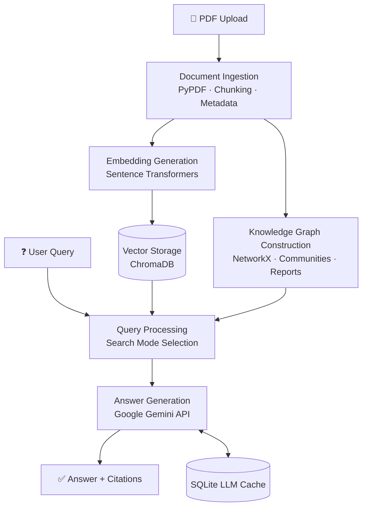

# 📄 RAG Document Q&A System

### Multi-PDF Retrieval-Augmented Generation with GraphRAG-Inspired Search


An AI-powered document question-answering application that lets users upload multiple PDF documents and retrieve accurate, context-aware answers using **vector-based retrieval** and **knowledge graph-based search**.

The system integrates **LangChain, ChromaDB, Sentence Transformers, Google Gemini API, and NetworkX** to support multiple retrieval strategies and evidence-backed responses.

---

## 📑 Table of Contents

1. [Key Features](#-key-features)
2. [Retrieval Modes](#-retrieval-modes)
3. [System Architecture](#-system-architecture)
4. [Persistent LLM Caching](#-persistent-llm-caching)
5. [Technology Stack](#-technology-stack)
6. [Project Structure](#-project-structure)
7. [Installation and Setup](#-installation-and-setup)
8. [Docker Deployment](#-docker-deployment)
9. [Security and Data Management](#-security-and-data-management)
10. [Future Enhancements](#-future-enhancements)

---

## ✨ Key Features

- **Multi-PDF Support** – Upload and process multiple PDF documents.
- **Traditional RAG** – Retrieve relevant document chunks using semantic vector search.
- **Local Search** – Retrieve focused information using knowledge graph entities and relationships.
- **Global Search** – Retrieve broader context using graph communities and community reports.
- **Hybrid Search** – Combine vector and graph retrieval for comprehensive results.
- **Knowledge Graph** – Represent relationships between extracted entities.
- **Evidence-Based Responses** – Generate answers grounded in retrieved document content.
- **Source Citations** – Provide references to supporting document evidence.
- **Persistent LLM Caching** – Store and reuse previous responses using SQLite.
- **Interactive Interface** – User-friendly Streamlit application.
- **Docker Support** – Run the application in a containerized environment.

---

## 🔍 Retrieval Modes

| Mode | Approach | Best For |
|------|----------|----------|
| **Traditional RAG** | Semantic similarity search over ChromaDB | Direct, fact-based questions |
| **Local Search** | Knowledge graph entities and relationships | Specific, entity-focused questions |
| **Global Search** | Graph communities and community reports | Broad, document-wide questions |
| **Hybrid Search** | Vector + graph retrieval combined | Comprehensive, evidence-rich answers |

### 1. Traditional RAG
- Uses semantic similarity search.
- Retrieves relevant chunks from ChromaDB.
- Passes retrieved context to Google Gemini.
- Generates context-aware answers.

### 2. Local Search
- Uses knowledge graph-based retrieval.
- Focuses on relevant entities and their relationships.
- Retrieves specific information connected to the user's query.

### 3. Global Search
- Uses graph communities and community reports.
- Retrieves broader information across the document collection.
- Supports questions requiring an overall understanding of multiple topics.

### 4. Hybrid Search
- Combines vector-based and graph-based retrieval.
- Integrates complementary contextual information.
- Generates comprehensive, evidence-supported answers.

---

## 🏗️ System Architecture

The application follows a **modular architecture** with six core components.



### 1. Document Ingestion
- PDF text extraction using **PyPDF**.
- Text preprocessing and chunking.
- Document metadata preparation.

### 2. Embedding Generation
- **Sentence Transformers** for semantic embeddings.
- Conversion of document chunks into vector representations.

### 3. Vector Storage
- **ChromaDB** for persistent vector storage.
- Semantic similarity-based document retrieval.

### 4. Knowledge Graph Construction
- Entity and relationship extraction.
- Graph representation using **NetworkX**.
- Community detection and report generation.

### 5. Query Processing
- User query handling.
- Retrieval through the selected search mode.
- Context preparation for response generation.

### 6. Answer Generation
- **Google Gemini API** integration.
- Context-aware response generation.
- Evidence and citation handling.

---

## 💾 Persistent LLM Caching

The system implements **SQLite-based persistent caching** to reduce repeated LLM requests.

**Key capabilities:**
- Stores previously generated LLM responses.
- Uses namespace-based cache organization.
- Retrieves matching responses using cache keys.
- Tracks cache **HIT** and **MISS** events.
- Reuses cached responses for matching requests.
- Reduces redundant API calls.

---

## 🛠️ Technology Stack

| Category | Technologies |
|----------|--------------|
| Programming Language | Python 3.11 |
| Frontend | Streamlit |
| LLM | Google Gemini API |
| LLM Framework | LangChain |
| Embeddings | Sentence Transformers |
| Vector Database | ChromaDB |
| Knowledge Graph | NetworkX |
| Graph Processing | Graspologic |
| PDF Processing | PyPDF |
| Data Validation | Pydantic |
| Caching | SQLite |
| Containerization | Docker, Docker Compose |

---

## 📁 Project Structure

```text
Rag-Document-QA/
│
├── app.py                 # Streamlit application
├── ingestion.py           # PDF ingestion and processing
├── vector_store.py        # Vector database operations
├── graph_rag.py           # Knowledge graph retrieval
├── search.py              # Retrieval and search logic
├── evidence.py            # Evidence and citation handling
├── llm_cache.py           # Persistent LLM caching
│
├── requirements.txt       # Python dependencies
├── Dockerfile             # Docker image configuration
├── docker-compose.yml     # Container orchestration
├── .dockerignore          # Docker build exclusions
├── .gitignore             # Git exclusions
├── .env.example           # Environment variable template
└── README.md              # Project documentation
```

---

## 🚀 Installation and Setup

### Prerequisites
- Python 3.11
- Git
- Google Gemini API key
- Docker Desktop *(optional)*

### Step 1: Clone the Repository
```bash
git clone https://github.com/r-sanjana/Rag-Document-QA.git
cd Rag-Document-QA
```

### Step 2: Create a Virtual Environment
```bash
python -m venv .venv
```

Activate the environment:

```bash
# Windows
.venv\Scripts\activate

# macOS / Linux
source .venv/bin/activate
```

### Step 3: Install Dependencies
```bash
python -m pip install --upgrade pip
pip install -r requirements.txt
```

### Step 4: Configure the API Key
Create a `.env` file in the project root directory:

```env
GEMINI_API_KEY=your_gemini_api_key
```

Replace the placeholder with your actual API key.

> ⚠️ **Security Note:** Never upload API keys or `.env` files to GitHub.

### Step 5: Run the Application
```bash
streamlit run app.py
```

Open the application in your browser: **http://localhost:8501**

---

## 🐳 Docker Deployment

The application supports containerized execution using Docker and Docker Compose.

| Action | Command |
|--------|---------|
| Build the image | `docker compose build` |
| Start the application | `docker compose up -d` |
| Check running containers | `docker ps` |
| View application logs | `docker compose logs -f` |
| Stop the application | `docker compose down` |

Access the application at: **http://localhost:8501**

---

## 🔒 Security and Data Management

- API credentials are configured through environment variables.
- Sensitive configuration files are excluded from version control.
- Local databases and generated cache files are excluded from Git.
- Uploaded PDF documents are not included in the repository.
- Docker volumes are used for persistent ChromaDB storage.

---

## 🔮 Future Enhancements

- [ ] Support for additional document formats
- [ ] Improved retrieval accuracy and ranking
- [ ] Advanced document management capabilities
- [ ] Enhanced caching and performance optimization
- [ ] Cloud deployment with persistent storage
- [ ] Improved scalability for larger document collections

---
